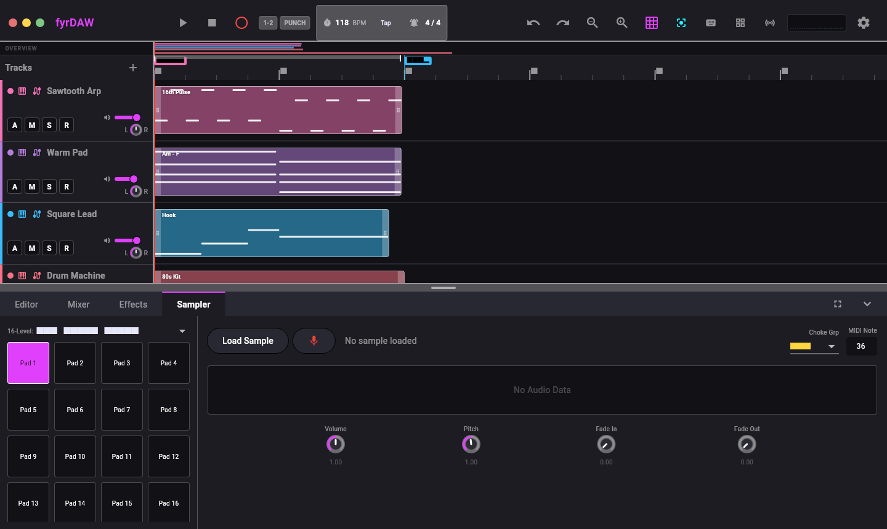

# fyrDAW

A desktop Digital Audio Workstation built in **Flutter** and **C++/SoLoud DSP** for Linux — featuring multi-track audio & MIDI recording, 17 built-in multi-sampled instruments, a 16-pad chop sampler, reorderable stompbox & mastering FX, Group Bus routing, real-time Arpeggiator & Groove tools, an Ableton-style Session Clip Launcher, hardware MIDI Learn, Reference Track LUFS A/B comparison, and offline WAV / FLAC / MP3 / Stem export.


---

## Table of Contents

- [Features at a Glance](#features-at-a-glance)
- [1. Top Bar, Transport & Project Templates](#1-top-bar-transport--project-templates)
- [2. Track Types & Group Bus Routing](#2-track-types--group-bus-routing)
- [3. Arrangement Timeline & Surgical Audio Tools](#3-arrangement-timeline--surgical-audio-tools)
- [4. Piano Roll, Synth Rack & Real-Time MIDI FX](#4-piano-roll-synth-rack--real-time-midi-fx)
- [5. 16-Pad Sampler & Slicing](#5-16-pad-sampler--slicing)
- [6. Stompbox Effects & Dedicated Mastering Chain](#6-stompbox-effects--dedicated-mastering-chain)
- [7. Mixing Console, Pre/Post Aux Sends & Reference A/B](#7-mixing-console-prepost-aux-sends--reference-ab)
- [8. Session Clip Launcher & Hardware MIDI Learn](#8-session-clip-launcher--hardware-midi-learn)
- [9. Saving Projects (.adaw) & Exporting Mixdowns / Stems](#9-saving-projects-adaw--exporting-mixdowns--stems)
- [Keyboard Shortcuts](#keyboard-shortcuts)
- [Building & Installation (Linux)](#building--installation-linux)

---

## Features at a Glance

- **4 Track Types**: Audio, MIDI Instrument, 16-Pad Sampler, and collapsible **Group / Bus (`BUS`)** tracks.
- **17 Built-In Multi-Sampled Instruments**: Analog synths (`Square Lead`, `Sawtooth Bass`, `Sine Sub`), keys & organs (`Grand Piano`, `Electric Piano (Rhodes)`, `Hammond B3 Organ`, `Cathedral Pipe Organ`), guitars (`Clean`, `Overdriven`, `Acoustic`), orchestral (`Solo Cello`, `Solo Violin`, `String Ensemble`, `Brass Section`, `Concert Flute`), and pads (`Choir Pad (Ahh)`, `Analog Warm Pad`).
- **Real-Time MIDI FX**: Built-in **Arpeggiator** (`Up`, `Down`, `Up/Down`, `Random`, rate, 1–3 octaves, gate), **Humanize**, and **Audio-Transient Groove Extract**, plus live **Synth ADSR & Filter** shaping.
- **Surgical Audio Editing**: Peak **Normalize (-1 dBFS)**, **Strip Silence**, **Extract Melody to MIDI Track**, **Auto-Match BPM**, **Pitch/Time Stretch**, **Take Comping Lanes**, **Slice to Sampler Track**, and automatic **Overlap Crossfades**.
- **11 Stompbox Effects + Master Rack**: `EQ` (interactive curve), `Compressor` (with cross-track **Sidechain Ducking**), `TubeScreamer`, `GuitarAmp`, `Reverb`, `Echo`, `Flanger`, `Chorus`, `Lofi`, `Robotize`, and `BassBoost`.
- **Pro Mixing & Mastering**: Group Bus summing, **Pre/Post-Fader** Aux Sends, Aux Return **Solo**, dedicated **Master FX** chain, integrated LUFS meter with selectable targets (`-14` / `-11` / `-9` LUFS), Stereo Correlation meter, Brickwall Limiter, and **Loudness-Matched Reference A/B** auditioning.
- **Live Performance & Hardware**: Next-bar quantized **Session Clip Launcher** (`Scene` & per-clip launching), built-in **QWERTY Musical Typing Keyboard**, ALSA/USB hardware MIDI routing, and 1-click **MIDI Learn (`0xB0` CC)**.

---

## 1. Top Bar, Transport & Project Templates

Start fast from **Settings (`⚙`) -> `New from Template...`**:

- **Empty Project** (`120 BPM`) — 1 Audio + 1 MIDI track ready to record.
- **Lo-Fi Chill Sketch** (`85 BPM`) — Rhodes chords, Sine Sub, vinyl Lofi FX, and Sampler kit.
- **Guitar + Vocals Rig** (`112 BPM`) — Armed vocal track (`EQ` + `Compressor`) and Guitar pedalboard (`TubeScreamer` -> `GuitarAmp` -> `Reverb`).
- **Synthwave 4-Track** (`118 BPM`) — Sawtooth Arp, Warm Pad, Square Lead, and Drum Machine.
- **Cinematic Strings & Piano** (`92 BPM`) — Grand Piano, Strings, and Hall Reverb.

### Top Bar Controls
- **Transport**: Play/Pause (`Space`), Stop (`Enter` returns to loop start or bar 1), Record (`R`).
- **Count-In (`1-2` / `1B` / `2B`)**: Cycles between Off, 1-Bar, and 2-Bar metronome count-in before recording begins.
- **Punch-In (`PUNCH`)**: Jumps playhead inside the loop brace and punches in/out automatically.
- **Tempo & Meter**: Type BPM directly or click **Tap** for tap-tempo; toggle the Metronome bell icon and change time signature (`3/4` to `7/4`).
- **Tools (Right)**: Undo/Redo, Zoom In/Out, Snap to Grid, Auto-Follow Playhead, **QWERTY Musical Typing Keyboard**, **Session View / Timeline Toggle**, **MIDI Learn Mode**, live Master FFT Spectrum, and Settings (`New`, `Templates`, `Open`, `Save`, `Save As`, `Export Mixdown`, `Export Stems`, `Preferences`).
- **Timeline Overview Minimap & Song Markers**: Click/drag the top `OVERVIEW` strip to scrub long arrangements, right-click the ruler to add labeled **Song Markers** (`Intro`, `Chorus`, `Drop`), or drag the top loop bar ends to toggle/resize loop regions.

---

## 2. Track Types & Group Bus Routing

Click the **`+`** button next to `Tracks` to add:
- **Audio Track**: Records live microphone/interface input or imports WAV/MP3/FLAC files. Includes **Headphones Monitor** toggle and Input Tuner/Noise Gate in the Effects tab.
- **MIDI Track**: Triggers any of the 17 built-in instruments (click the piano icon to browse instruments, or the cable icon to select a hardware MIDI input port).
- **Sampler Track**: Opens the 16-Pad chop sampler in the bottom panel (`Sampler` tab).
- **Group Bus (`BUS`)**: Dedicated sub-mix bus that sums routed child tracks cleanly through shared Group Effects, Group Fader/Pan, Mute/Solo propagation, and Group Sends.

### Routing Tracks to a Group Bus
1. Create a Group Bus via **`+` -> `Add Group Bus`** (badged **`BUS`** in amber).
2. **Right-click** any Audio, MIDI, or Sampler track header and choose **`Route to Group Bus...`**.
3. Child tracks display a colored **`GRP`** badge matching their parent bus.
4. Click the chevron (`v` / `>`) beside **`BUS`** on the Group header to collapse/expand all child lanes in both headers and timeline views.

> Muting or Soloing a Group Bus automatically propagates to all routed child tracks during both live playback and offline mixdown rendering.

---

## 3. Arrangement Timeline & Surgical Audio Tools

- **Multi-Take Comping**: Recording audio over an existing clip automatically appends numbered takes (`Take 1`, `Take 2`, ...). Right-click the clip to audition/switch takes non-destructively.
- **Automatic Overlap Crossfades**: Whenever two Audio Clips on the same track overlap, fyrDAW computes smooth raised-cosine crossfade curves automatically in both live playback and WAV/Stem mixdown.
- **Clip Edge Trimming, Looping & Fades**: Drag clip edges to trim or loop (with notch indicators), drag top corners for Fade In / Fade Out curves, or split any clip at the playhead (**`Split at Playhead`**).
- **Track Automation (`A`)**: Toggle **`A`** on any track header to expose break-point automation lanes for `Volume`, `Pan`, `Reverb Send`, `Delay Send`, or any active Effect parameter (`Effect_Param`). Right-click the lane to insert/clear points.

### Audio Clip Context Menu
Right-click any Audio Clip in the timeline to access surgical audio tools:
- **Normalize (-1 dBFS)**: Scans peak amplitude and renders a normalized WAV scaled to `-1 dBFS`, refreshing the clip waveform.
- **Strip Silence**: Analyzes amplitude envelopes and splits the clip cleanly into separate regions around silent gaps.
- **Extract Melody to MIDI Track**: Runs monophonic pitch tracking (`YIN`-based Hz detection) across the audio clip and creates a new MIDI Track populated with transcribed `MidiNote` events.
- **Gain & Pitch... / Stretch / Fit to Bars... / Auto-Match Project BPM**: Adjust clip gain, transpose in semitones, fit a loop cleanly to N bars, or auto-detect clip BPM and stretch to match project tempo.
- **Reverse Audio / Slice to Sampler Track**: Non-destructively reverse playback or transient-slice the clip straight into 16 Sampler pads.

---

## 4. Piano Roll, Synth Rack & Real-Time MIDI FX

Select any MIDI clip (or double-click an empty MIDI lane to create one) and open the bottom **`Editor`** tab:

- **Scale & Chord Tools**: Choose a musical key/scale (`Major`, `Minor`, `Harmonic Min`, `Dorian`, `Pentatonic`, `Blues`) to highlight/snap notes in-key, or use **Chords** to stamp common triads & 7th voicings directly onto the grid.
- **Ghost Notes & Linked Patterns**: Enable Ghost Notes to view translucent notes from overlapping MIDI tracks for tight harmonic counterpoint. Right-click a clip -> **`Duplicate as Linked Alias`** so edits mirror across chorus/verse copies (`Make Unique` detaches an instance).
- **Embedded Step Sequencer**: Toggle pattern grid step entry for fast drum or synth programming, including instant 4-step kick/snare/hat fills.
- **Velocity Lane**: Toggle the equalizer icon in the toolbar to draw expressive per-note velocities below the Piano Roll.
- **Real-Time Synth Panel (`Synth`)**: Shape the track's instrument voice with live **ADSR Envelope** (`ATK`, `DEC`, `SUS`, `REL`), resonant lowpass filter (**`CUTOFF`**, **`RESO`**), **Octave Shift**, and **Detune**.

### Real-Time MIDI FX Rack (`Arp`, `Humanize` & `Groove`)
- **Arpeggiator (`Arp`)**: Click **`Arp`** in the MIDI toolbar to reveal the **ARP FX** strip:
  - Enable/disable with the switch.
  - Choose pattern direction (**`Up`**, **`Down`**, **`Up/Down`**, **`Random`**), sync rate (`1/4`, `1/8`, `1/16`), **Octaves** (`1`–`3`), and **Gate** length slider (`15%`–`100%`).
  - Runs live while holding notes on hardware MIDI or QWERTY Musical Typing, during live timeline playback, and inside offline Mixdowns!
- **Humanize**: Adds natural micro-timing swing and velocity variation across all notes in the clip.
- **Audio Groove Extraction (`Groove`)**: When Audio Clips exist in your project, use the Groove menu to detect transient onsets from any audio loop and quantize your MIDI notes directly to that pocket.

### QWERTY Musical Typing Keyboard
Click the keyboard icon in the top bar (or open the bottom bar) to play notes directly from your computer keyboard (`A W S E D F T G Y H U J K`), shift octaves with **`Z` / `X`**, and adjust velocity with **`C` / `V`**.

---

## 5. 16-Pad Sampler & Slicing



Select a Sampler Track and open the **`Sampler`** tab:
- **16 Performance Pads**: Click `Load Sample` to assign WAV/audio files, or click the mic button to record a one-shot directly onto the active pad.
- **Interactive Waveform & Per-Pad Controls**: Adjust `Volume`, `Pitch` (semitones), `Fade In`, and `Fade Out` knobs alongside MIDI note trigger mapping (`36`+ GM drum layout).
- **16-Level Mode**: Switch pads into **`Vel`**, **`Pitch`**, or **`Filter`** stepped performance mode across all 16 pads.
- **Choke Groups**: Assign pads (e.g., Open & Closed Hi-Hats) to the same colored **Choke Grp** so triggering one immediately mutes the other.
- **Transient Slicing**: Right-click any Audio Clip -> **`Slice to Sampler Track`** to auto-detect drum hits/transients into up to 16 sliced pads AND generate a chromatic MIDI pattern triggering each slice in order.

---

## 6. Stompbox Effects & Dedicated Mastering Chain


Open the **`Effects`** tab to shape any track — or the entire Master Bus:
- **Drag-to-Reorder Pedalboard**: Click **`+ Add Effect`** to insert `EQ`, `Compressor`, `TubeScreamer`, `GuitarAmp`, `Reverb`, `Echo`, `Flanger`, `Chorus`, `Lofi`, `Robotize`, or `BassBoost`. Drag cards horizontally to reorder the DSP signal chain, toggle pedal bypass LEDs, or click expand (`⤢`) to open the large Pedal Inspector with live curve/modulation visualizers.
- **Chain Presets (`Presets`)**: Instantly load **`Crunch Guitar Rig`**, **`Vocal Polish Chain`**, **`Lo-Fi Tape Machine`**, **`Wide Ambient Space`**, or **`Clear All Effects`**.
- **Sidechain Compression**: On any `Compressor` pedal, select another track as its **Sidechain Source** (`SC`) to duck bass or pads whenever your kick hits — rendered accurately in both live playback and mixdown!
- **Chromatic Tuner & Noise Gate (Audio Tracks)**: Choose your audio input device, toggle the live **Tuner** (`Hz` / note / cents needle), and dial in the **Noise Gate** threshold to silence room hiss between takes.
- **Dedicated Master Bus FX Chain (`TRACK FX` / `MASTER FX`)**: Click the **`TRACK FX`** pill in the right sidebar to switch the rack to **`MASTER FX`**. Any EQ, Compression, Reverb, or saturation placed on Master is applied across the final mix bus live and baked into final exports.

---

## 7. Mixing Console, Pre/Post Aux Sends & Reference A/B


Open the **`Mixer`** tab for a full multi-channel console:
- **Channel Strips (`TRACK` / `BUS`)**: Each track provides **Rev Send (`REV`)** and **Delay Send (`DLY`)** rotary dials, **Pan (`PAN`)**, smooth fader, dual L/R segmented **VU meters with peak-hold**, and **`M` / `S`** buttons.
- **Pre / Post-Fader Send Toggles (`PRE` / `PST`)**: Click **`PST`** / **`PRE`** directly below `REV` or `DLY` on any strip to send signal before or after the channel fader.
- **Shared Aux Return Strips (`FX A: REV`, `FX B: DLY`)**: Control master Aux Reverb & Delay return mix levels and solo either wet return in isolation via its **`S`** button to dial in effects cleanly.
- **Master Bus Strip**:
  - **LUFS Integrated Meter & Target**: Displays live integrated loudness vs target (`-14`, `-11`, or `-9` LUFS — click the readout to cycle streaming/club targets).
  - **Stereo Correlation Meter (`+1` to `-1`)**: Spot phase cancellation immediately.
  - **Brickwall Limiter (`LIMIT`)**: Protects master output against digital clipping.
  - **Loudness-Matched Reference A/B (`+REF` -> `MIX A` / `REF B`)**: Click **`+REF`** to load any `.wav` / `.mp3` / `.flac` / `.ogg` reference master. For WAV files, fyrDAW estimates integrated LUFS and gain-matches the reference to your target LUFS; click **`MIX A` / `REF B`** to toggle instantly between your mix and reference track (`long-press` loads a new reference).

---

## 8. Session Clip Launcher & Hardware MIDI Learn


### Live Session Clip Launcher
Toggle **`Switch to Session Clip Launcher`** (grid icon in the top bar) to switch from linear arrangement to a live performance grid:
- Trigger individual clip slots (`16th Pulse`, `Am - F`, `Hook`, etc.) — if the transport is already playing, the clip arms in amber and launches **quantized to the next bar boundary**; if stopped, playback starts immediately.
- Trigger full horizontal rows from the right-hand **`SCENES`** strip (`Scene 1`, `Scene 2`, ...).
- Mute (`M`), Solo (`S`), or `STOP` individual tracks directly per column, or double-click any slot to jump straight into its Piano Roll or Effects view.

### Hardware MIDI Learn (`Icons.sensors`)
1. Connect a hardware MIDI controller (auto-discovered via Linux ALSA/MIDI).
2. Click the **`MIDI Learn Mode`** sensor icon in the top bar (lights amber).
3. Click any track's mixer fader percentage label in the **Mixer** tab (switches to **`TWIST`**).
4. Move any physical knob or fader (`CC 0xB0`) on your controller — it immediately binds to that fader (`min..max`) and saves automatically inside `.adaw` projects.

---

## 9. Saving Projects (.adaw) & Exporting Mixdowns / Stems

- **Save / Open (`.adaw`)**: `Ctrl+S` / Settings -> `Save As...` creates a portable `.adaw` ZIP archive bundling `project.json` (tracks, Group Buses, clips, automation, Master FX chain, MIDI CC mappings, LUFS target) alongside all referenced WAV audio files.
- **Crash Auto-Save Recovery**: Changes auto-save periodically in the background; on relaunch after an unexpected exit, fyrDAW prompts to **Recover** or **Discard** unsaved work.
- **Export Mixdown (`WAV` / `FLAC` / `MP3`)**: Settings -> `Export Mixdown` runs the offline `MixdownRenderer` (Group Bus summing, Pre/Post sends, Arp expansion, Overlap crossfades, Sidechain compression, Synth filters, Stompbox FX, Master FX chain & Limiter) to 16-bit 44.1 kHz stereo **WAV**, or transcodes via `ffmpeg` to lossless **FLAC** / **320 kbps MP3**.
- **Export Stems**: Settings -> `Export Stems` renders every track individually as its own WAV file into your chosen folder.

---

## Keyboard Shortcuts

| Shortcut | Context | Action |
|---|---|---|
| `Space` | Global | Play / Pause (or stop active recording) |
| `R` | Global | Toggle Recording on armed tracks |
| `Enter` / `Numpad Enter` | Global | Return playhead to Loop Start (or `0.0`) |
| `Ctrl + Z` / `Ctrl + Shift + Z` | Global | Undo / Redo |
| `Ctrl + C` / `Ctrl + V` | Timeline / Piano Roll | Copy / Paste selected clips or MIDI notes |
| `Delete` / `Backspace` | Timeline / Piano Roll | Delete selected clips or MIDI notes |
| `Ctrl + =` / `Ctrl + -` | Timeline | Zoom In / Zoom Out |
| `Ctrl + S` | Global | Save project (`.adaw`) |
| `A W S E D F T G Y H U J K` | Musical Typing Active | Play chromatic notes on selected MIDI/Sampler track |
| `Z` / `X` | Musical Typing Active | Octave Down / Up (`C1`–`C7`) |
| `C` / `V` | Musical Typing Active | Velocity Down / Up (`20`–`127`) |

---

## Building & Installation (Linux)

Ensure you have [Flutter](https://flutter.dev/docs/get-started/install/linux) configured for Linux desktop development, plus system packages: `alsa-lib`, `ffmpeg`, `zenity`, `clang`, `cmake`, `ninja-build`, and `pkg-config`.

1. Navigate to the repository and fetch dependencies:
   ```bash
   cd fyrdaw
   flutter pub get
   ```
2. Run in development mode or run the test suite:
   ```bash
   flutter run -d linux
   flutter test
   ```
3. Build a Linux debug or release bundle:
   ```bash
   flutter build linux
   ```
   Output bundle is generated in `build/linux/x64/release/bundle/`.

### Desktop Installer
The `installer/` directory contains `install.sh`, which detects your package manager (`pacman`, `apt`, etc.), installs runtime dependencies (`alsa-lib`, `ffmpeg`, `zenity`, `fmedia`), copies the bundle to `/opt/fyrDAW`, and registers a desktop launcher entry:

```bash
cd installer
sudo ./install.sh
```

> **Note for Arch Linux users**: If `fmedia` is not in core repos, install it via your AUR helper (e.g., `yay -S fmedia`).
