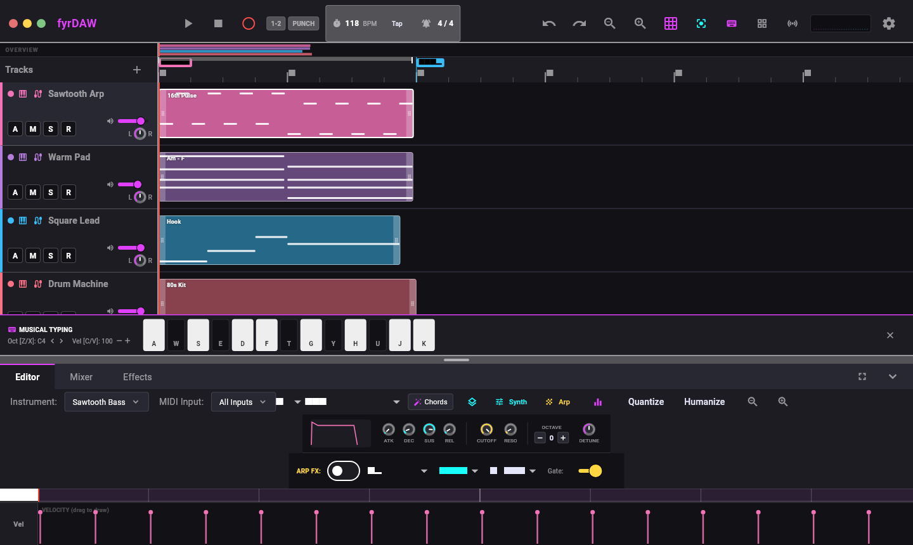
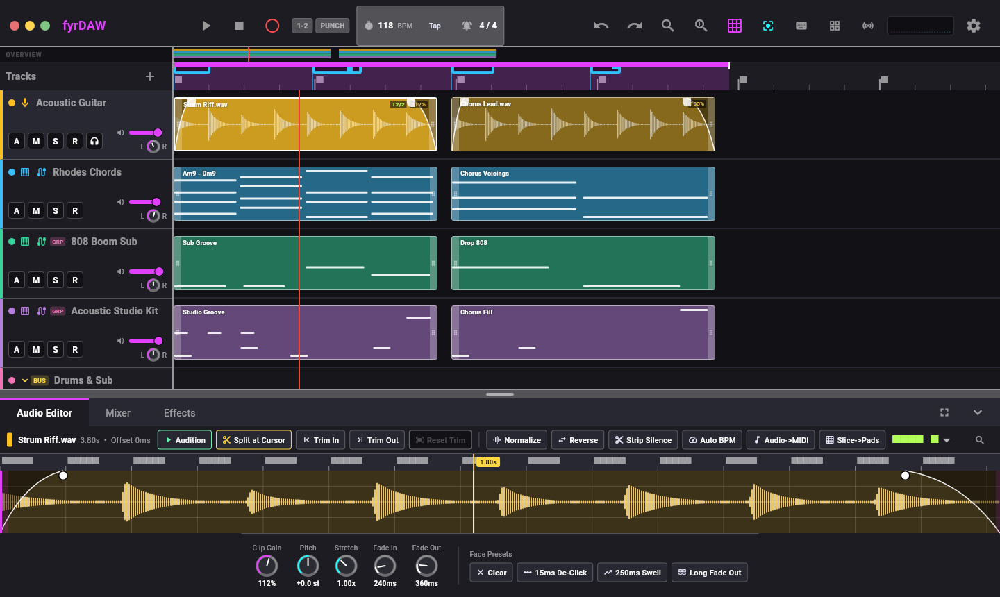
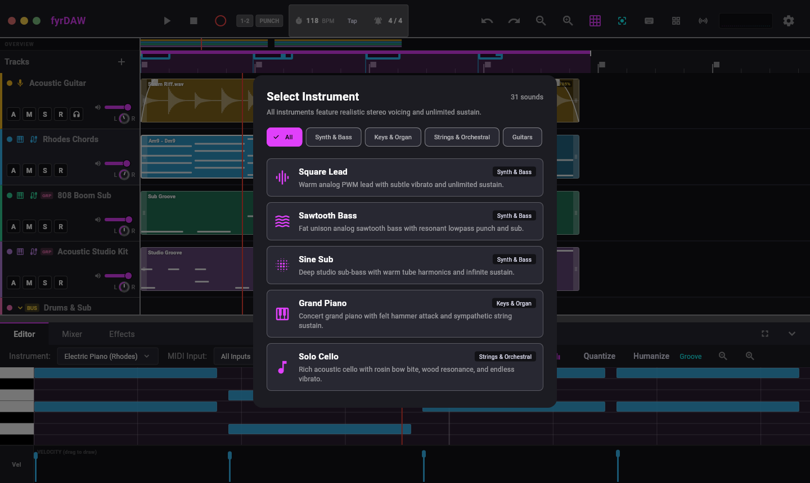
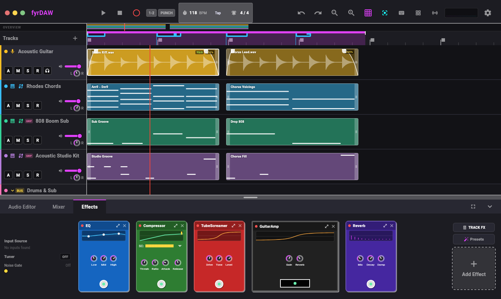
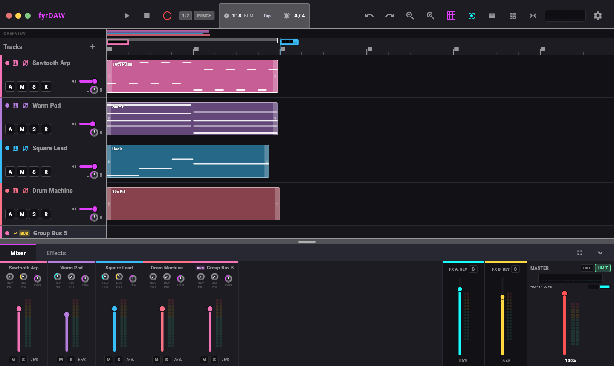
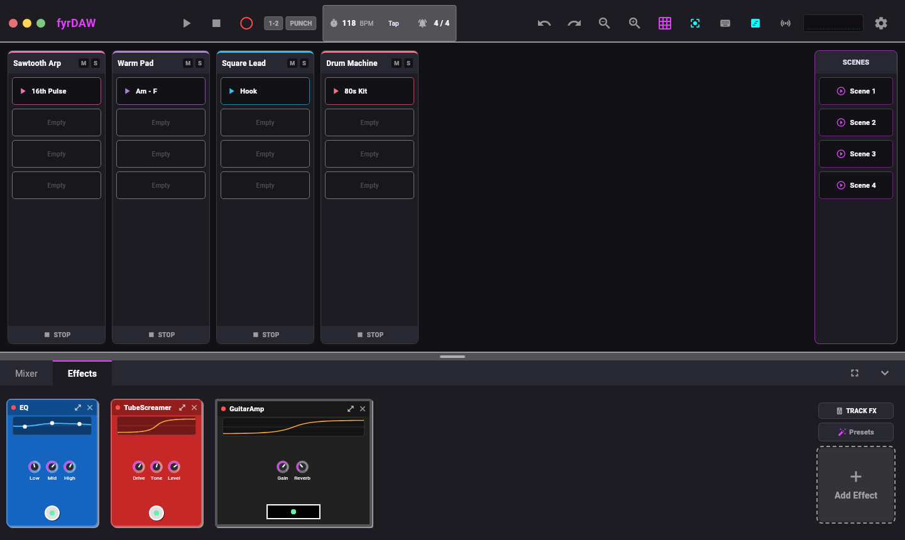

# Sound Booth

A desktop Digital Audio Workstation built in **Flutter** and **C++/SoLoud DSP** for Linux — featuring multi-track audio & MIDI recording, **31 built-in multi-sampled instruments**, a **16-pad chop sampler** with bundled studio/808/boombap drum kits, a close-up **Audio Clip Editor**, reorderable stompbox & mastering FX, color-synced **Group Bus** routing & live **dBFS metering**, real-time **Arpeggiator & Groove** tools, an Ableton-style **Session Clip Launcher**, hardware **MIDI Learn**, **Reference Track LUFS A/B**, and offline WAV / FLAC / MP3 / Stem export.



---

## Table of Contents

- [Features at a Glance](#features-at-a-glance)
- [1. Top Bar, Transport & Project Templates](#1-top-bar-transport--project-templates)
- [2. Track Types & Group Bus Routing](#2-track-types--group-bus-routing)
- [3. Arrangement Timeline & Close-Up Audio Clip Editor](#3-arrangement-timeline--close-up-audio-clip-editor)
- [4. Virtual Instruments, Piano Roll & Real-Time MIDI FX](#4-virtual-instruments-piano-roll--real-time-midi-fx)
- [5. 16-Pad Sampler, Drum Kits & Transient Slicing](#5-16-pad-sampler-drum-kits--transient-slicing)
- [6. Stompbox Effects & Dedicated Mastering Chain](#6-stompbox-effects--dedicated-mastering-chain)
- [7. Mixing Console, Synced Track Colors & Live dBFS Metering](#7-mixing-console-synced-track-colors--live-dbfs-metering)
- [8. Session Clip Launcher & Hardware MIDI Learn](#8-session-clip-launcher--hardware-midi-learn)
- [9. Saving Projects (.adaw) & Exporting Mixdowns / Stems](#9-saving-projects-adaw--exporting-mixdowns--stems)
- [Keyboard Shortcuts](#keyboard-shortcuts)
- [Building & Installation (Linux)](#building--installation-linux)

---

## Features at a Glance

- **4 Track Types**: Audio, MIDI Instrument, 16-Pad Sampler, and collapsible **Group / Bus (`BUS`)** tracks with consistent color coding across Timeline headers, clips, and Mixer strips.
- **31 Built-In Multi-Sampled Virtual Instruments**: Acoustic/electric instruments, studio pianos & mallets, brass/woodwinds, strings, choirs, analog synths, and **Pure Deep Sine / 808 / Reese Sub** basses.
- **3 Realistic Drum Kits + Custom Kit Persistence**: Built-in **Acoustic Studio Kit**, **808 Trap Kit**, and **Vintage Boom-Bap Kit** loaded with stereo WAV samples, choke groups, 16-level modes, and custom kit save/load/delete.
- **Close-Up Audio Clip Editor**: Double-click any Audio clip on the timeline to open a dedicated zoomed waveform view for non-destructive trimming, cursor splitting, fade curves, gain/pitch/stretch dials, normalization, and transient slicing.
- **Real-Time MIDI FX**: Double-click any MIDI or Sampler clip to open the Piano Roll with built-in **Arpeggiator** (`Up`, `Down`, `Up/Down`, `Random`, rate, 1–3 octaves, gate), **Humanize**, **Audio-Transient Groove Extract**, **Step Sequencer**, and **Synth ADSR & Filter** shaping.
- **11 Stompbox Effects + Master Rack**: `EQ`, `Compressor` (with cross-track **Sidechain Ducking**), `TubeScreamer`, `GuitarAmp`, `Reverb`, `Echo`, `Flanger`, `Chorus`, `Lofi`, `Robotize`, and `BassBoost`.
- **Pro Mixing & Live Per-Track dBFS Metering**: Color-matched channel strips with `-48..0 dBFS` L/R VU meters and live peak dBFS readouts, Group Bus level summing, **Pre/Post-Fader** Aux Sends, Aux Return **Solo**, dedicated **Master FX** chain, integrated **LUFS meter** (`-14` / `-11` / `-9`), Stereo Correlation meter, Brickwall Limiter, and **Loudness-Matched Reference A/B**.
- **Live Performance & Hardware**: Next-bar quantized **Session Clip Launcher** (`Scene` & per-clip launching), built-in **QWERTY Musical Typing Keyboard**, ALSA/USB hardware MIDI routing, and 1-click **MIDI Learn (`0xB0` CC)**.

---

## 1. Top Bar, Transport & Project Templates

Start fast from **Settings (`⚙`) -> `New from Template...`**:

- **Empty Project** (`120 BPM`) — 1 Audio + 1 MIDI track ready to record.
- **Lo-Fi Chill Sketch** (`85 BPM`) — Rhodes chords, Sine Sub, vinyl Lofi FX, and Sampler kit.
- **Guitar + Vocals Rig** (`112 BPM`) — Armed vocal track (`EQ` + `Compressor`) and Guitar pedalboard (`TubeScreamer` -> `GuitarAmp` -> `Reverb`).
- **Synthwave 4-Track** (`118 BPM`) — Sawtooth Arp, Warm Pad, Square Lead, and Drum Machine.
- **Cinematic Strings & Piano** (`92 BPM`) — Grand Piano, Solo Cello, String Ensemble, and Hall Reverb.

### Top Bar Controls
- **Transport**: Play/Pause (`Space`), Stop (`Enter` returns to loop start or bar 1), Record (`R`).
- **Count-In (`1-2` / `1B` / `2B`)**: Cycles between Off, 1-Bar, and 2-Bar metronome count-in before recording begins.
- **Punch-In (`PUNCH`)**: Jumps playhead inside the loop brace and punches in/out automatically.
- **Tempo & Meter**: Type BPM directly or click **Tap** for tap-tempo; toggle the Metronome bell icon and change time signature (`3/4` to `7/4`).
- **Tools (Right)**: Undo/Redo, Zoom In/Out, Snap to Grid, Auto-Follow Playhead, **QWERTY Musical Typing Keyboard**, **Session View / Timeline Toggle**, **MIDI Learn Mode**, live Master FFT Spectrum, and Settings (`New`, `Templates`, `Open`, `Save`, `Save As`, `Export Mixdown`, `Export Stems`, `Preferences`).
- **Timeline Overview Minimap, Loop Bar & Song Markers**: Click/drag the top `OVERVIEW` strip to scrub long arrangements, right-click the ruler to add labeled **Song Markers** (`Intro`, `Verse 1`, `Chorus`, `Drop`), click the top loop bar to toggle looping, drag its left/right edge handles to resize, or drag the bar body to relocate the entire loop region.

---

## 2. Track Types & Group Bus Routing

Click the **`+`** button next to `Tracks` to add:
- **Audio Track**: Records live microphone/interface input or imports WAV/MP3/FLAC files. Includes **Headphones Monitor** toggle and Input Tuner/Noise Gate in the Effects tab.
- **MIDI Track**: Triggers any of the **31 built-in instruments** (click the piano icon on the header to browse by category, or the cable icon to select a hardware MIDI input port).
- **Sampler Track**: Opens the 16-Pad chop sampler in the bottom panel (`Sampler` tab).
- **Group Bus (`BUS`)**: Dedicated sub-mix bus that sums routed child tracks cleanly through shared Group Effects, Group Fader/Pan, Mute/Solo propagation, and Group Sends.

### Routing Tracks to a Group Bus
1. Create a Group Bus via **`+` -> `Add Group Bus`** (badged **`BUS`** in the track's own color).
2. **Right-click** any Audio, MIDI, or Sampler track header and choose **`Route to Group Bus...`**.
3. Child tracks display a colored **`GRP`** badge matching their parent bus.
4. Click the chevron (`v` / `>`) beside **`BUS`** on the Group header to collapse/expand all child lanes in both headers and timeline views.

> Muting, Soloing, or metering a Group Bus propagates across all routed child tracks during live playback, Mixer metering, and offline mixdown rendering.

---

## 3. Arrangement Timeline & Close-Up Audio Clip Editor



**Double-click any Audio segment** on the timeline (or select an audio track/clip and open the **`Audio Editor`** tab) to inspect and sculpt the clip up close:
- **Interactive Zoomed Waveform & Cursor**: Click/drag along the close-up waveform or time ruler to set a split/trim cursor (`ms`/`s` readout), zoom in/out on transients, and click **`Audition`** to preview immediately.
- **Non-Destructive Trim & Split**: Use **`<| Trim In`**, **`|> Trim Out`**, **`Split at Cursor`**, or **`Reset Trim`** to tighten start/end boundaries cleanly with grid snap support.
- **Fade Curves & Presets**: Drag the Fade In / Fade Out corner handles or use the rotary dials and 1-click presets (**`Clear`**, **`15ms De-Click`**, **`250ms Swell`**, **`Long Fade Out`**).
- **Clip Gain, Pitch & Stretch**: Dial in clip gain (`%`), semitone pitch transposition, and speed/stretch multiplier in real time.
- **Multi-Take Comping & Overlap Crossfades**: Recording over an existing audio region stacks numbered takes (`T1/2`, `T2/2`...) you can switch non-destructively via right-click, while overlapping audio clips compute automatic raised-cosine crossfades.
- **One-Click Surgical DSP Tools** (available in both the **`Audio Editor`** toolbar and Audio Clip context menu):
  - **`Normalize`**: Peaks audio cleanly to `-1 dBFS` and refreshes the waveform.
  - **`Reverse`**: Non-destructively toggles reversed playback.
  - **`Strip Silence`**: Detects silent gaps and splits the clip cleanly around active audio regions.
  - **`Auto BPM`**: Estimates clip tempo and stretches cleanly to match project BPM.
  - **`Audio->MIDI`**: Runs YIN monophonic pitch tracking to transcribe the audio melody into a new MIDI track.
  - **`Slice->Pads`**: Auto-detects transient hits and maps up to 16 audio slices straight into a new Sampler Track + chromatic MIDI trigger pattern.

---

## 4. Virtual Instruments, Piano Roll & Real-Time MIDI FX



**Double-click any MIDI or Sampler segment** on the timeline to jump straight into the bottom **`Editor` (Piano Roll)** tab. Click the piano icon on any MIDI track header (or the **`Instrument`** selector in the MIDI toolbar) to browse **31 stereo multi-sampled sounds** across 7 categories:

| Category | Instruments |
|---|---|
| **Synth & Bass / Leads** | `Square Lead`, `Sawtooth Bass`, `Sine Sub`, `Supersaw Trance Lead`, `Analog Poly Brass`, `Acid 303 Bass` |
| **Sine & 808 Bass** | `Pure Deep Sine Bass`, `808 Boom Sub`, `Detuned Reese Sub` |
| **Keys & Organ** | `Grand Piano`, `Electric Piano (Rhodes)`, `Hammond B3 Organ`, `Cathedral Pipe Organ` |
| **Keys & Mallets** | `Warm Felted Piano`, `Concert Marimba`, `Concert Harp`, `FM Glassy Bell` |
| **Guitars & Bass** | `Clean Electric Guitar`, `Overdriven Guitar`, `Acoustic Guitar`, `Nylon Spanish Guitar`, `Upright Acoustic Bass`, `Fingered Electric Bass` |
| **Strings & Orchestral** | `Solo Cello`, `Solo Violin`, `String Ensemble`, `Brass Section`, `Concert Flute`, `Tenor / Alto Sax` |
| **Pads & Choir** | `Choir Pad (Ahh)`, `Analog Warm Pad` |

### Piano Roll, Step Sequencer & MIDI FX
- **Scale & Chord Tools**: Highlight/snap notes to `Major`, `Minor`, `Harmonic Min`, `Dorian`, `Pentatonic`, or `Blues`, or stamp triads & 7th chords directly from **Chords**.
- **Ghost Notes & Linked Patterns**: Overlay translucent notes from other MIDI tracks, or right-click a clip -> **`Duplicate as Linked Alias`** so pattern edits mirror across chorus/verse copies (`Make Unique` detaches).
- **Embedded Step Sequencer & Velocity Lane**: Toggle grid step sequencing with instant drum grooves or draw per-note velocities along the bottom lane.
- **Real-Time Synth Panel (`Synth`)**: Shape voice envelopes (**`ATK`**, **`DEC`**, **`SUS`**, **`REL`**), resonant lowpass filter (**`CUTOFF`**, **`RESO`**), **Octave**, and **Detune**.
- **Arpeggiator (`Arp`), Humanize & Groove**: Enable live arpeggiation (`Up`, `Down`, `Up/Down`, `Random`, `1/4`–`1/32` rate, `1`–`3` octaves, Gate `%`), micro-timing **`Humanize`**, or **`Groove`** extraction quantized to transients detected in your Audio clips.
- **QWERTY Musical Typing Keyboard**: Toggle the keyboard icon in the top bar to play chromatic notes (`A W S E D F T G Y H U J K`), shift octaves (`Z` / `X`), and adjust velocity (`C` / `V`).

---

## 5. 16-Pad Sampler, Drum Kits & Transient Slicing


Select a Sampler Track and open the **`Sampler`** tab (or double-click its timeline clip to edit trigger notes in the Piano Roll):
- **Built-In Drum Kit Presets**: Load **`Acoustic Studio Kit`**, **`808 Trap Kit`**, or **`Vintage Boom-Bap Kit`** from the **`Kit`** menu to populate pads with realistic studio birch drums, sub-heavy 808s, or dusty SP-1200 breaks complete with live waveforms and choke groups.
- **Custom Sampler Kits**: Click **`Save`** next to the kit selector to save, overwrite, reload, or delete custom user drum kits across sessions.
- **16 Performance Pads & Chop Waveform**: Click `Load Sample` to import WAV/audio files or click the red mic button to record directly onto any pad; drag the range trimmers on the pad waveform, flip **`Reverse`**, or tweak **`Volume`**, **`Pitch`**, **`Fade In`**, **`Fade Out`**, and **`MIDI Note`** (`36`+ GM layout).
- **16-Level Mode & Choke Groups**: Play stepped **`16-Level Velocity`** or **`16-Level Pitch`** variations of the active pad across all 16 buttons, and assign Open/Closed Hi-Hats to **`Choke Grp A–D`** for authentic cymbal choking.

---

## 6. Stompbox Effects & Dedicated Mastering Chain



Open the **`Effects`** tab to process any Track, Group Bus, or the Master Bus:
- **Drag-to-Reorder Pedalboard**: Click **`+ Add Effect`** to insert `EQ`, `Compressor`, `TubeScreamer`, `GuitarAmp`, `Reverb`, `Echo`, `Flanger`, `Chorus`, `Lofi`, `Robotize`, or `BassBoost`. Drag cards to reorder DSP signal flow, toggle bypass LEDs, or expand (`⤢`) any pedal for large curve & modulation visualizers.
- **Chain Presets (`Presets`)**: Instantly load **`Crunch Guitar Rig`**, **`Vocal Polish Chain`**, **`Lo-Fi Tape Machine`**, **`Wide Ambient Space`**, or **`Clear All Effects`**.
- **Sidechain Compression (`SC`)**: On any `Compressor` pedal, route another track (such as Kick/Sampler) as its Sidechain trigger to duck basslines, guitars, or pads cleanly in both live playback and offline mixdown.
- **Chromatic Tuner & Noise Gate (Audio Tracks)**: Choose an input device, tune guitars/vocals with the live Hz/cents needle, and set the input Noise Gate threshold.
- **Master Bus FX (`TRACK FX` / `MASTER FX`)**: Toggle the sidebar pill to **`MASTER FX`** to insert mastering EQ, bus compression, reverb, or saturation across the entire stereo mix.

---

## 7. Mixing Console, Synced Track Colors & Live dBFS Metering



Open the **`Mixer`** tab for a full multi-channel console:
- **Synced Track Colors**: Every Mixer channel strip, top accent bar, left border, tint, fader slider, and Group **`BUS`** badge mirrors its exact Timeline track and clip color (`Track.color`). Right-clicking a clip or clicking a track color swatch updates both Timeline and Mixer simultaneously.
- **Per-Track `-48..0 dBFS` VU Meters & Peak Readouts**: Every Audio, MIDI, Sampler, and Group Bus strip monitors live native SoLoud channel amplitudes (`-48..0 dBFS` logarithmic scaling), displaying dual segmented L/R VU bars alongside a numeric peak dBFS readout (`-2.9dB`, `-4.0dB`, `-∞`), plus aggregated child-track summing on Group Buses.
- **Pre/Post-Fader Sends & Aux Returns**: Adjust **`REV`** and **`DLY`** sends with 1-click **`PST` / `PRE`** toggles, Pan dials, Mute (`M`) / Solo (`S`), and dedicated **`FX A: REV`** / **`FX B: DLY`** Aux Return strips (with Aux Solo `S`).
- **Master Bus Strip**:
  - **LUFS Integrated Meter & Target**: Displays live loudness vs target (`-14`, `-11`, or `-9` LUFS — click the readout to cycle streaming/club targets).
  - **Stereo Correlation Meter (`+1` to `-1`)**: Spot phase issues immediately.
  - **Brickwall Limiter (`LIMIT`)**: Prevents digital clipping at the master output.
  - **Loudness-Matched Reference A/B (`+REF` -> `MIX A` / `REF B`)**: Load any `.wav` / `.mp3` / `.flac` / `.ogg` reference track, auto-gain-match WAV references to your LUFS target, and A/B instantaneously (`long-press` loads a new file).

---

## 8. Session Clip Launcher & Hardware MIDI Learn



### Live Session Clip Launcher
Toggle **`Switch to Session Clip Launcher`** (grid icon in the top bar) to switch from linear arrangement to a live performance grid containing both Audio and MIDI clips:
- Trigger individual clip slots (`Strum Riff.wav`, `Am9 - Dm9`, `Sub Groove`, `Studio Groove`, etc.) — while playing, newly triggered slots arm in amber and launch **quantized to the next bar boundary**; when stopped, playback starts immediately.
- Launch entire horizontal rows from the **`SCENES`** column (`Scene 1`, `Scene 2`, ...), or `M` / `S` / `STOP` tracks per column.

### Hardware MIDI Learn
1. Connect a hardware MIDI controller (auto-discovered via Linux ALSA/MIDI).
2. Click the **`MIDI Learn Mode`** sensor icon in the top bar (lights amber).
3. Click any track's mixer fader percentage label in the **Mixer** tab (switches to **`TWIST`**).
4. Move any physical knob or fader (`CC 0xB0`) on your controller — it immediately binds to that fader (`min..max`) and saves automatically inside `.adaw` projects.

---

## 9. Saving Projects (.adaw) & Exporting Mixdowns / Stems

- **Save / Open (`.adaw`)**: `Ctrl+S` / Settings -> `Save As...` creates a portable `.adaw` ZIP archive bundling `project.json` (tracks, Group Buses, clips, automation, Master FX chain, MIDI CC mappings, LUFS target) alongside all referenced WAV audio files.
- **Crash Auto-Save Recovery**: Changes auto-save periodically in the background; on relaunch after an unexpected exit, Sound Booth prompts to **Recover** or **Discard** unsaved work.
- **Export Mixdown (`WAV` / `FLAC` / `MP3`)**: Settings -> `Export Mixdown` runs the offline `MixdownRenderer` (Group Bus summing, Pre/Post sends, Arp expansion, Overlap crossfades, Sidechain compression, Synth filters, Stompbox FX, Master FX chain & Limiter) to 16-bit 44.1 kHz stereo **WAV**, or transcodes via `ffmpeg` to lossless **FLAC** / **320 kbps MP3**.
- **Export Stems**: Settings -> `Export Stems` renders every track individually as its own WAV file into your chosen folder.

---

## Keyboard Shortcuts

| Shortcut | Context | Action |
|---|---|---|
| `Space` | Global | Play / Pause (or stop active recording) |
| `R` | Global | Toggle Recording on armed tracks |
| `Enter` / `Numpad Enter` | Global | Return playhead to Loop Start (or `0.0`) |
| `Ctrl + Z` / `Ctrl + Shift + Z` | Global | Undo / Redo |
| `Ctrl + C` / `Ctrl + V` | Timeline / Piano Roll | Copy / Paste selected clips or MIDI notes |
| `Delete` / `Backspace` | Timeline / Piano Roll | Delete selected clips or MIDI notes |
| `Ctrl + =` / `Ctrl + -` | Timeline | Zoom In / Zoom Out |
| `Ctrl + S` | Global | Save project (`.adaw`) |
| `A W S E D F T G Y H U J K` | Musical Typing Active | Play chromatic notes on selected MIDI/Sampler track |
| `Z` / `X` | Musical Typing Active | Octave Down / Up (`C1`–`C7`) |
| `C` / `V` | Musical Typing Active | Velocity Down / Up (`20`–`127`) |

---

## Building & Installation (Linux)

Ensure you have [Flutter](https://flutter.dev/docs/get-started/install/linux) configured for Linux desktop development, plus system packages: `alsa-lib`, `ffmpeg`, `zenity`, `clang`, `cmake`, `ninja-build`, and `pkg-config`.

1. Navigate to the repository and fetch dependencies:
   ```bash
   cd fyrdaw
   flutter pub get
   ```
2. Run in development mode or run the test suite:
   ```bash
   flutter run -d linux
   flutter test
   ```
3. Build a Linux debug or release bundle:
   ```bash
   flutter build linux
   ```
   Output bundle is generated in `build/linux/x64/release/bundle/`.

### Desktop Installer
The `installer/` directory contains `install.sh`, which detects your package manager (`pacman`, `apt`, etc.), installs runtime dependencies (`alsa-lib`, `ffmpeg`, `zenity`, `fmedia`), copies the bundle to `/opt/fyrdaw`, and registers a desktop launcher entry (`Sound Booth`):

```bash
cd installer
sudo ./install.sh
```

> **Note for Arch Linux users**: If `fmedia` is not in core repos, install it via your AUR helper (e.g., `yay -S fmedia`).
